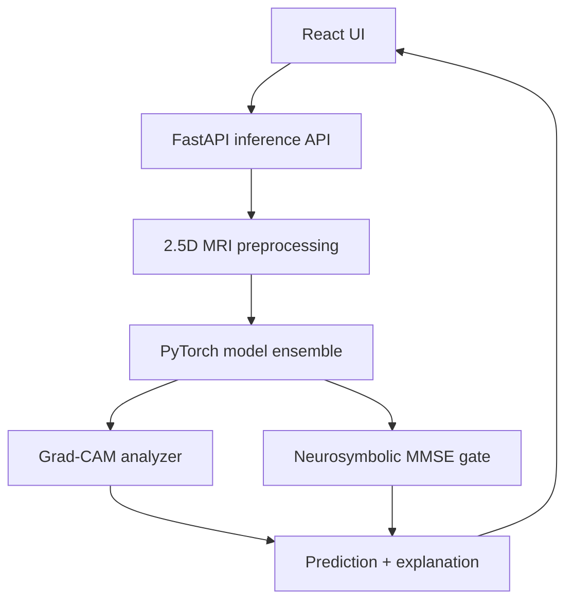
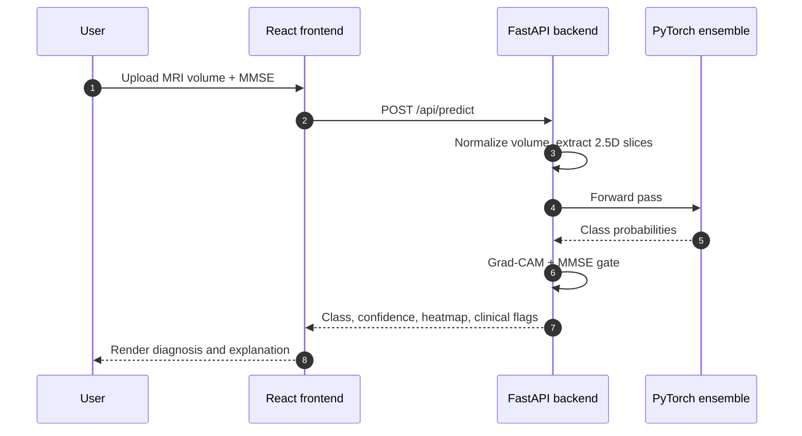
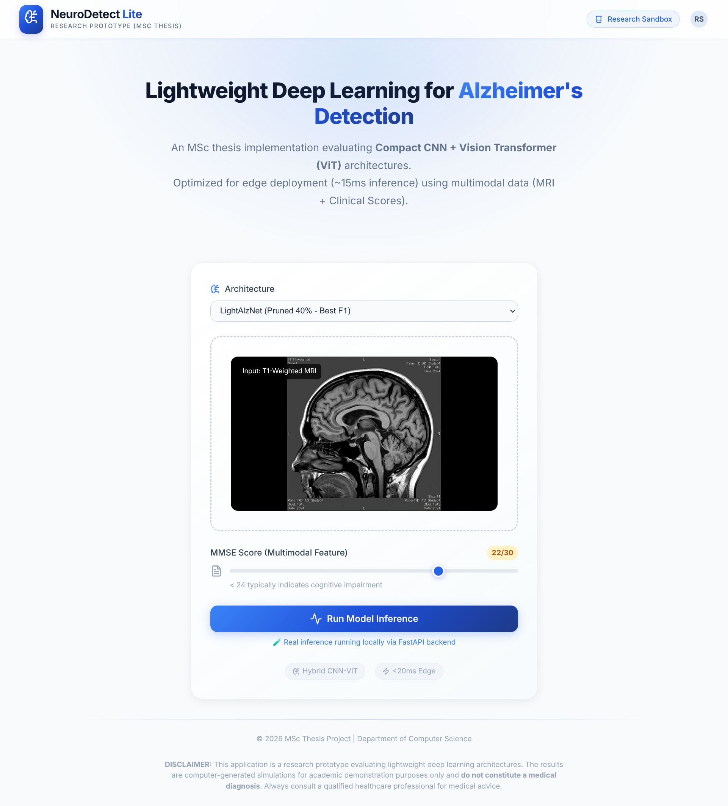
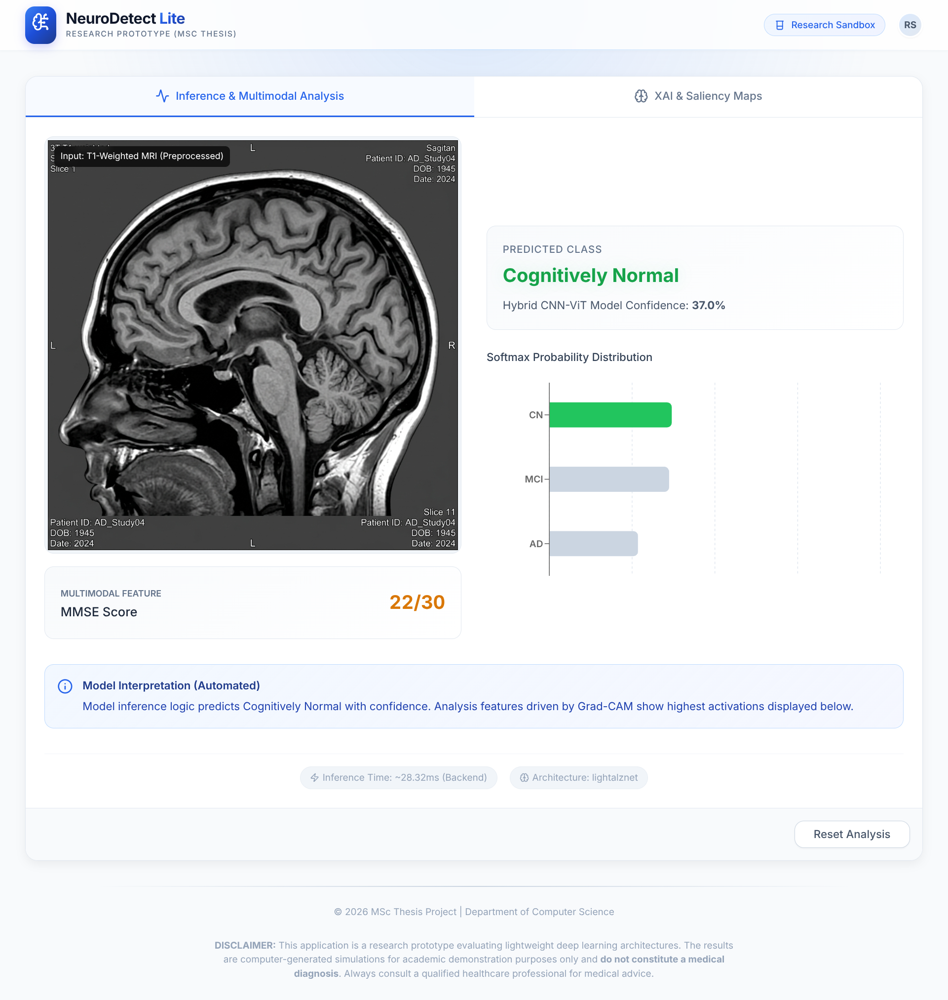
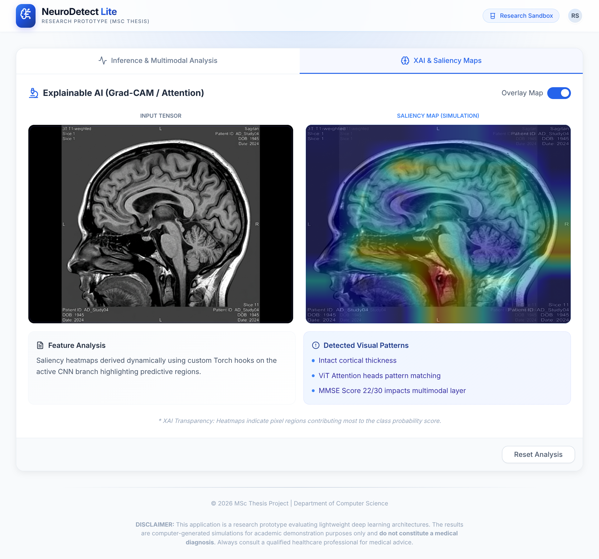

# NeuroDetect Lite 🧠

[](#thesis)
[](LICENSE)
[](https://neuro-detect-lite.vercel.app)
[](https://fastapi.tiangolo.com/)
[](https://reactjs.org/)
[](https://pytorch.org/)

**NeuroDetect Lite** is a research prototype for three-class Alzheimer's
disease staging from structural MRI. It combines a lightweight 2.5D CNN
ensemble, Grad-CAM explanations, and a deterministic MMSE-based clinical gate
in a FastAPI + React application designed for CPU-only inference.

> **Master's thesis:** *A Neuro-Symbolic Clinical Decision Support System for
> Early Alzheimer's Detection* — defended in 2026 with a mark of **18/20**.
>
> **Live demo:** <https://neuro-detect-lite.vercel.app>

**This is a research prototype, not a medical device.** Do not use it for
clinical diagnosis.

---

## Thesis

The thesis contributes a complete, edge-deployable pipeline:

1. A **7-channel 2.5D MRI representation** (5 axial + 2 coronal slices) that
   avoids the cost of full 3D convolutions.
2. An ablation across **six architectures** — LightAlzNet, PlainCNN,
   EfficientNet-B0, MobileNetV3, GhostNetV2, and TinyViT — with patient-level
   5-fold cross-validation.
3. A **neurosymbolic MMSE gate** that applies seven deterministic clinical
   rules, flags image/clinical conflicts, and escalates ambiguous MCI cases
   instead of silently trusting the network.
4. **INT8 quantization** for CPU deployment, with selective quantization to
   preserve classifier accuracy.

### Headline results

| System | Key result |
|---|---|
| **LightAlzNet** | 0.63M parameters · **49.81% macro-F1** |
| **LightAlzNet INT8** | **1.93 MB** · ~10 ms CPU inference |
| **5-model ensemble** | **55.74% accuracy** · 0.6886 AUC |
| **Ensemble + MMSE gate** | **73.86% accuracy** (from ~55.7% baseline; McNemar p = 0.003) |

These are the final defended numbers. The full per-fold table, confidence
intervals, and ablation details are in the thesis; the paper draft and figures
are under [`writing-article/`](writing-article/).

---

## Architecture



The diagnostic flow:



---

## Screenshots

| Diagnosis view | Grad-CAM | Model comparison |
|:---:|:---:|:---:|
|  |  |  |

---

## Quick start

### Backend (FastAPI, CPU-only)

```bash
cd back-end
python -m venv .venv
source .venv/bin/activate        # Windows: .venv\Scripts\activate
pip install -r requirements.txt
python main.py
```

The API starts on <http://localhost:8000>. It downloads model weights from
Hugging Face on first run if they are not already present locally. See
[`models/README.md`](models/README.md) for the expected layout and manual
download command.

### Frontend (React + Vite)

```bash
cd front-end
npm install
cp .env.example .env.local       # optional: point at a local backend
npm run dev
```

### Docker

```bash
docker build -t neurodetect-lite ./back-end
docker run --rm -p 7860:7860 neurodetect-lite
```

---

## Repository layout

| Path | Purpose |
|---|---|
| `back-end/` | FastAPI inference API, 2.5D preprocessing, Grad-CAM, MMSE gate |
| `front-end/` | React + Vite interface |
| `Colab Notebooks/` | Training and experiment notebooks |
| `models/` | Weight-download instructions; weights are not stored in Git |
| `writing-article/` | Paper source, PDF, and screenshots |
| `front-end/public/sample-scans/` | Synthetic demo volumes (not patient data) |

---

## Reproducibility

- The training notebooks are in [`Colab Notebooks/`](Colab%20Notebooks/). They
  were developed on Kaggle/Colab and expect the ADNI-derived manifests
  described in the thesis.
- The repository does **not** contain patient data, OASIS/ADNI volumes, or
  model checkpoints.
- The three demo volumes under `front-end/public/sample-scans/` are synthetic
  phantoms generated for interface testing. They are not patient scans.
- Model weights are distributed separately on
  [Hugging Face](https://huggingface.co/subarufly17/neurodetectlite-models).

If you need to reproduce the full training run, obtain the source data under
its data-use agreement and follow the notebook order. The thesis documents the
splits and preprocessing.

---

## Data and clinical notice

This repository contains **no patient data**. The original OASIS-derived sample
scans and the third-party paper PDFs were removed because their licences do not
permit redistribution in a public repository.

The system is a research prototype. It has not been validated prospectively,
has not received regulatory approval, and must not be used as a substitute for
clinical judgement. The MMSE gate is a decision-support heuristic, not a
diagnosis.

---

## Citation

If you use this work, please cite the thesis:

```bibtex
@mastersthesis{belalia2026neurodetect,
  title  = {A Neuro-Symbolic Clinical Decision Support System for Early Alzheimer's Detection},
  author = {Belalia, Mohamed Oussama and Belghitar, Kheireddine},
  school = {Université Ibn Khaldoun, Tiaret},
  year   = {2026},
  note   = {Master's thesis, defended with 18/20}
}
```

A machine-readable [`CITATION.cff`](CITATION.cff) is included.

---

## License

Released under the [MIT License](LICENSE). The licence covers the code in this
repository, not the underlying datasets or third-party papers.
